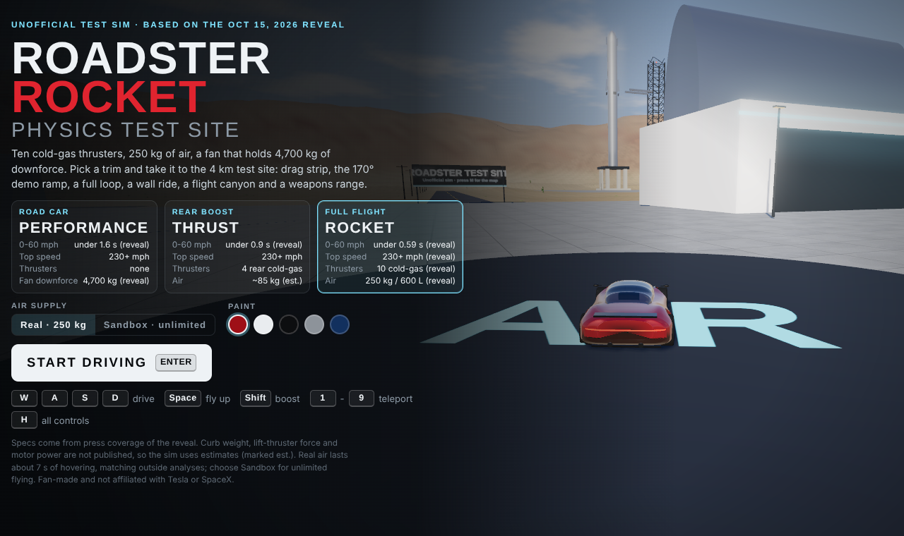
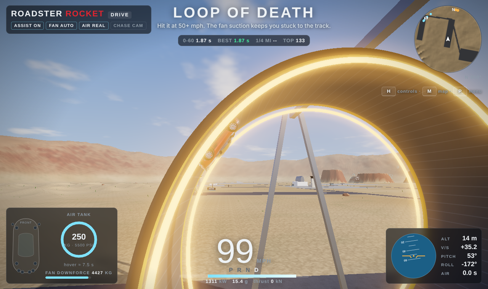
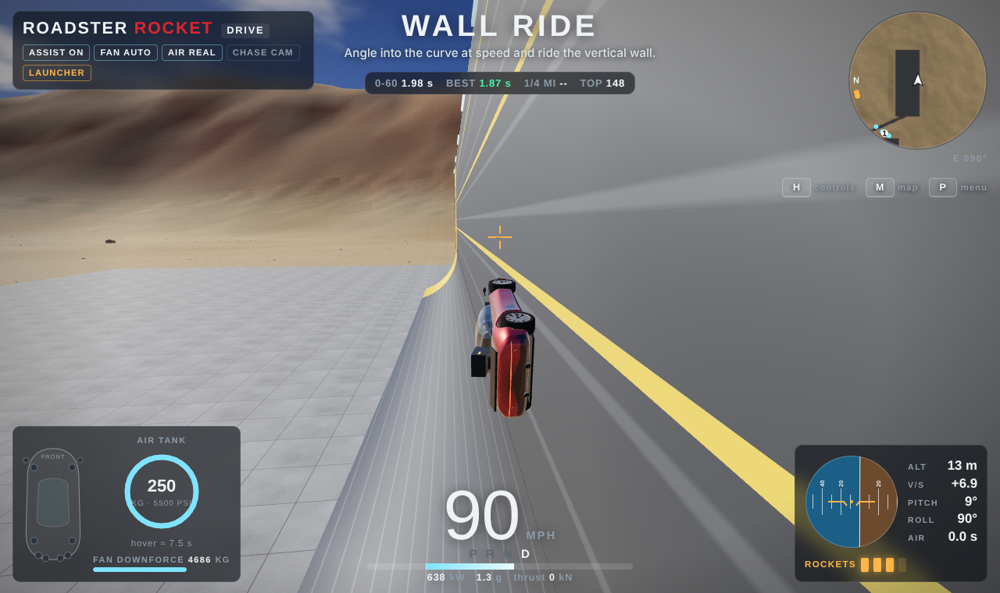
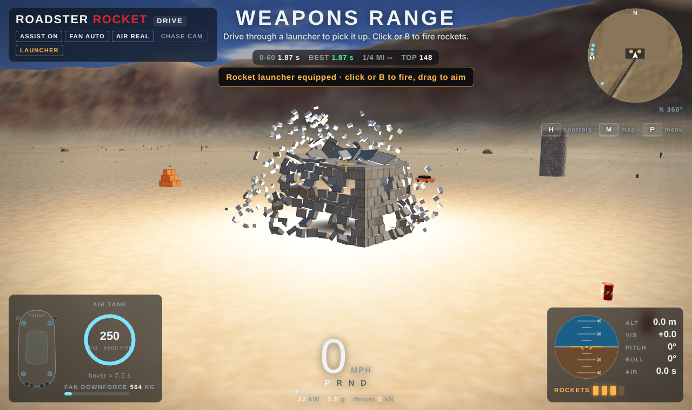
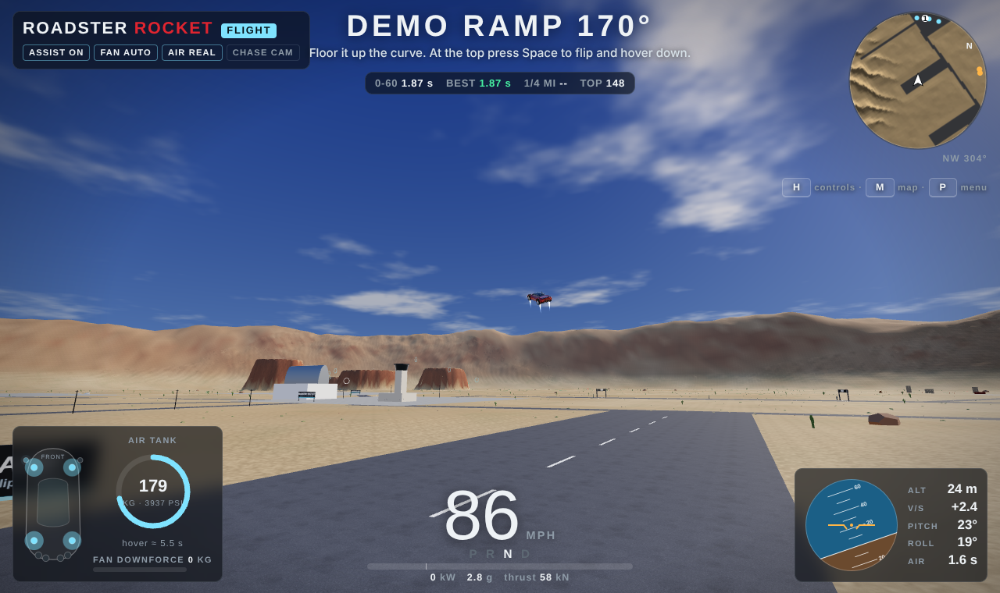
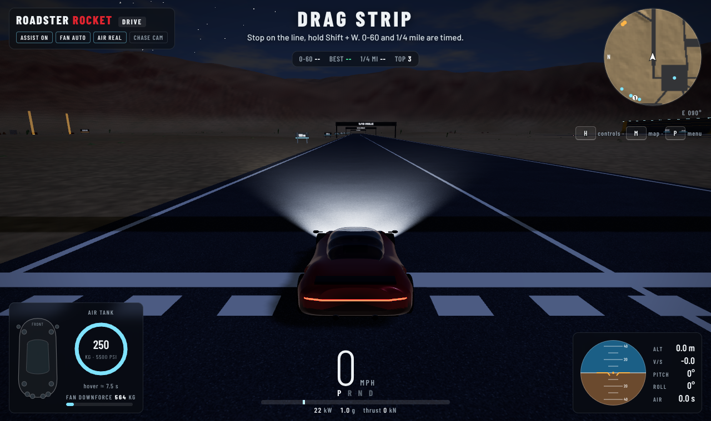

# Roadster Rocket Sim

An unofficial, fan-made 3D physics sim of the new Tesla Roadster (revealed Oct 15, 2026) and its
cold-gas thruster package, as a Windows desktop app. Not affiliated with Tesla or SpaceX.

**[⬇ Download the latest version for Windows](https://github.com/goldengoose100/roadster-rocket-sim/releases/latest)**

Drive it, fly it on 10 thrusters, ride walls with fan suction, loop the loop, and blow up a whole village
with roof-mounted rockets. Real physics: suspension, tire slip, 4,700 kg of fan downforce, 250 kg of air
that actually runs out, and buildings that collapse block by block.



## New in 2.5

- **Two new maps**, picked on the start screen (the game reloads on the new map):
  - **The Moon**: 1/6 gravity, craters, a lunar base, the Low-G Jump Zone and the Mega Ramp, the Moon Rock Mine
    weapons area with ragdoll dummies, Crater Canyon rings, a crashed lander, and Earth in the black sky.
  - **Neon City**: a night city with skyscrapers and neon signs, Drag Avenue, the Neon Tunnel, the elevated Skyway, the Demolition Yard and rings between the towers.
- The desert is unchanged.

## New in 2.4

- **Ragdoll dummies** in the Weapons Range: crash-test dummy, wooden training dummy, robot, mannequin, scarecrow,
  clown and a giant BOSS DUMMY, each with an HP bar. Every body part has its own health, so limbs come off at the
  joint nearest the hit (headshots knock them out). Blood (oil for the robot, straw, splinters), with a Blood
  on/off switch in the pause menu. Credits for every knockout; dummies respawn after 15 s, Backspace resets them,
  and the mod menu can spawn more.

## New in 2.3

- **Good Luck menu** (secret, needs its code): unlock everything, wear any of the 87 skins, turn the car into a
  banana, hot dog, rubber duck, toilet, shopping cart, couch, cheese wedge, pizza slice, watermelon, bathtub,
  giant sneaker or burger (looks only: it drives the same), and silly mods: monster wheels, tiny car, googly
  eyes, party hat, wobbly jelly car, rainbow trail, confetti explosions, fart boost, clown horn and bouncy car.

## New in 2.2

- **Skin cases** (Garage → Skins): a Street Case (1,500 CR) and an Elite Case (5,000 CR) with a spinning reel.
  37 skins in 5 rarities: Common (grey), Uncommon (green), Rare (blue), Epic (purple) and Legendary (gold).
  Duplicates refund half their value. Animated skins: neon lines, hologram, lava, galaxy, chrome, rainbow.
- **14 new guns** on top of rockets and the railgun: minigun, shotgun, grenade launcher, flamethrower, laser, plasma,
  sniper, mines, cluster bomb, black hole, tesla coil, orbital laser, meteor shower and the hammer.
  Tab / Shift+Tab to switch; hold the mouse for auto-fire.
- **Mod menu**: pick any gun, fire-rate slider, no bullet drop, giant shots, explosive rounds, rainbow tracers,
  nuke rounds, meteor shower / orbital laser / black hole / Armageddon buttons, +100K credits, unlock all case skins
  and 50 secret Dev skins you can only get from the menu.
- A new in-game update screen and a "What's new" screen after the update. (The startup update window gets the
  same look with the next full app download.)

## New in 2.0

- **Garage**: a showroom with a turntable (start screen or pause menu). 5 upgrades with 3 levels each
  (motor, tires, fan, thrust, air tank) that really change the physics, live stats measured with a test drive,
  cosmetics (paint, wheels, rear wing, underglow, thruster smoke) and 3 saved builds.
- **Credits** for 0-60 runs, the quarter mile, jumps, rings, flips and barrel rolls, the Loop of Death, the demo-ramp
  flip, wall rides and destruction. Saved on your computer.
- **Physics 2.0**: tires heat up, wear and change pressure; crashes crumple the panels where you hit, snap off parts
  and can tear a wheel off (park on the HQ pad to repair); downforce turns into lift as the nose rises; wind gusts;
  slipstream behind other cars; the air tank behaves like a real gas (it gets cold and thrust fades at the end);
  explosions send out shockwaves at the speed of sound that shatter windows.
- **Physics: 2.0 / Classic** in the pause menu. Classic is exactly the 1.x physics.

| | |
|---|---|
|  |  |
|  |  |
|  | |

## Download

Get the latest Windows zip from this repository's **Releases** page (or from whoever shared it with you).
Unzip it, open the folder and double-click **Roadster Rocket Sim.exe**. If Windows shows
"Windows protected your PC", click **More info → Run anyway** (the app isn't code-signed).

## Updates

From v1.1.0 on, the app updates itself. On launch it checks `updates/latest.json` in this repository;
if there is a newer version it offers to install it (about 1 MB). Downloads are checked against a
SHA-256 fingerprint, and if a new version fails to start the app rolls back to the last working one.
You can also check manually from the pause menu (P).

## How to play

| Key | Driving | Flying (Rocket trim) |
| --- | --- | --- |
| W / ↑ | Accelerate | Tilt forward |
| S / ↓ | Brake, then reverse | Tilt back |
| A D / ← → | Steer | Turn |
| Shift | Rocket boost | Boost forward |
| Space | | Lift off / climb |
| C | | Descend / soft landing |
| Q / E | | Barrel roll left / right (hold to slide) |
| X | Handbrake / drift | |
| F | Fan suction: Auto, Max, Off | |
| G | | Flight assist on / manual |
| Click or B | Fire rocket (after picking up a launcher) | same |
| R | Reset car upright | same |
| G (start screen) | Garage | |
| V | Camera: chase, far, cockpit, cinematic, orbit | |
| M | Big map (click to teleport) | |
| 1-9 | Teleport to zones | |
| Backspace | Rebuild everything you destroyed | |
| H / P / N | Controls / pause menu / sound | |
| F11 | Fullscreen | |

Let go of every key while flying and the assist hovers in place.

## Map

1. **Air Station HQ**: spawn; park on the glowing AIR pad to refill air, repair the car and fit new tires.
2. **Drag Strip**: 0-60 mph and 1/4 mile are timed automatically.
3. **Demo Ramp 170°**: the reveal stunt; flip and hover down at the top.
4. **Loop of Death**: follow the yellow line at 50+ mph.
5. **Wall Ride**: ride the vertical wall with fan suction.
6. **Jump Park**: jump 6 cars and a Semi, or the 13 m mega ramp.
7. **Flight Canyon**: 10 rings and mesa landing pads.
8. **Weapons Range**: rocket launchers and destructible buildings.
9. **Dunes**: off-road sand.

## Specs used

From coverage of the reveal: 10 cold-gas thrusters, 80+ kN rear thrust, 600 L / ~250 kg of air,
4,700 kg fan downforce, 0-60 mph under 0.59 s (Rocket), under 0.9 s (Thrust), under 1.6 s (Performance),
230+ mph. Curb weight, lift-thruster force and motor power aren't published, so those are estimates
(`src/config.js`).

## Building

```
npm install
npm run build:offline          # desktop/app/index.html (the game, fully offline)
node tools/package.mjs         # Windows app + zip in desktop/out/
node tools/release.mjs "notes" # writes updates/game-<version>.html + updates/latest.json
```

Tests:
- Headless: `node tools/physics-test.mjs`, `node tools/steer-test.mjs`, `node tools/hack-physics-test.mjs`,
  `node tools/physics2-test.mjs`, `node tools/garage-test.mjs`. `PHYSICS=classic` in front of the first three must
  print exactly the 1.1.5 numbers.
- In the desktop app (`node tools/package.mjs --linux-only` first, then prefix with `APP=1 xvfb-run -a`):
  `tools/play-test.mjs out/`, `tools/v2-test.mjs out/` (screenshots of every v2 feature),
  `tools/hack-test.mjs out/` (`HACK_CODE=...`, or `HACK_UNLOCK=1` to skip the code screen),
  `tools/luck-test.mjs out/` (`LUCK_CODE=...`, or `LUCK_UNLOCK=1` to skip the code prompt).
- Updater: `xvfb-run -a node tools/updater-test.mjs out/` (needs `node tools/package.mjs --linux`), and after
  `release.mjs`: `xvfb-run -a node tools/release-check.mjs out/` (an app on the previous version installs the new one).
